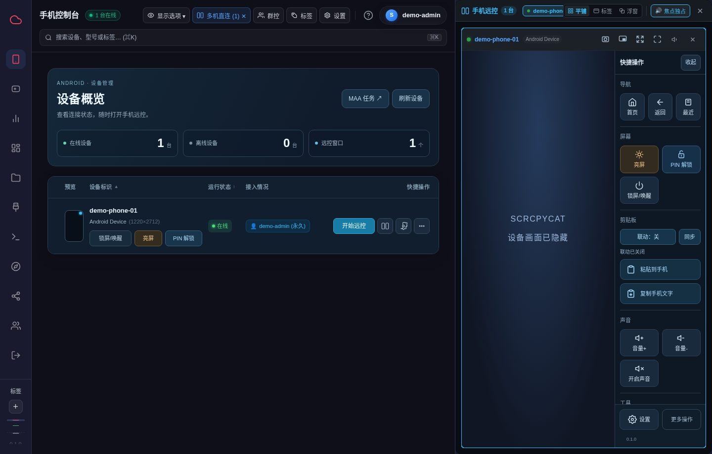
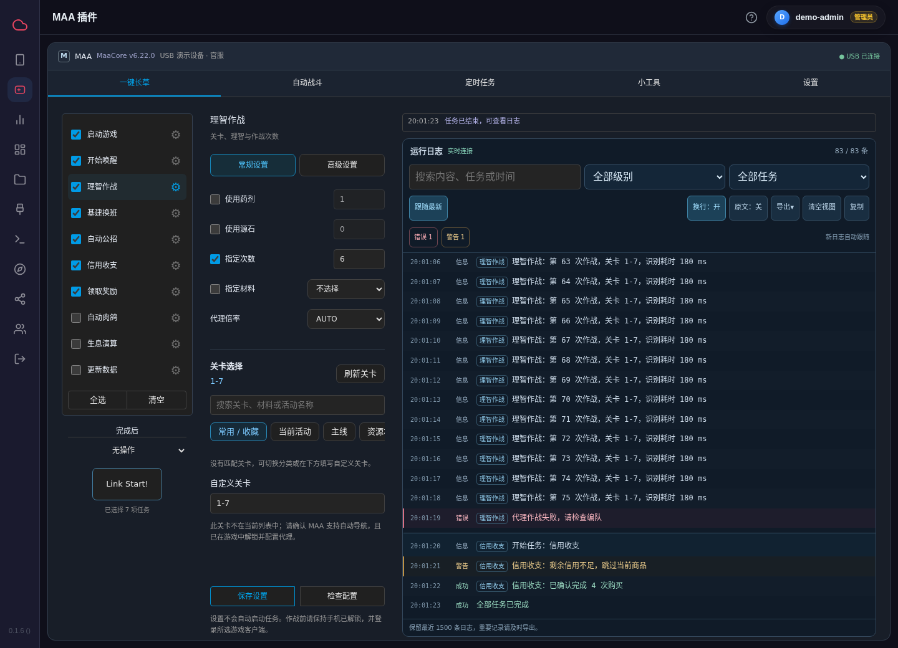
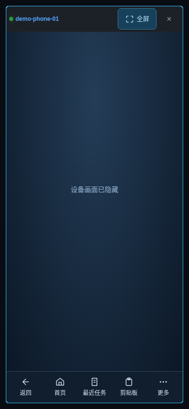
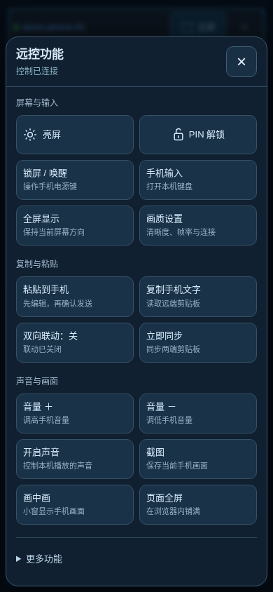
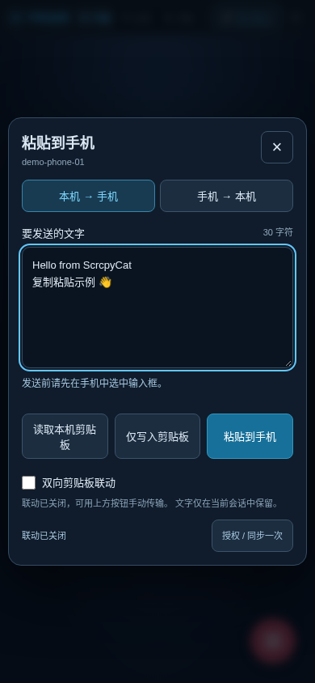

# scrcpy-web-docker · ScrcpyCat 可选插件版

Android 手机网页远控。主容器整合 Web 控制台、USB ADB 和 Linux agent；MAA 独立运行，服务就绪后才出现入口。停止 MAA 不影响远控。基于 [CwithW/ScrcpyCat](https://github.com/CwithW/ScrcpyCat) 修改，保留原许可和第三方声明。

## 界面预览

实际网页界面；设备信息替换为演示数据，投屏内容已隐藏，MAA 展示参数与日志未执行任务。



<details>
<summary>MAA 插件、手机远控与剪贴板</summary>








</details>

## 组成

| 服务 | 用途 | 必须 |
| --- | --- | --- |
| scrcpy-web | 网页、认证、投屏/触控、USB ADB、手机 agent | 是 |
| PostgreSQL 17 | 用户、设备、策略、审计等持久化数据 | 是，可使用现有实例 |
| scrcpycat-cache | Redis 消息总线、AOF 持久化和健康检查 | 是 |
| maa-web | MAA 插件任务执行、定时、核心/资源维护 | 否 |

开始投屏、重连和后台预览均保留实体屏幕原有状态；断开或重建投屏不会自动恢复亮屏。需要唤醒或亮屏时使用网页中的对应按钮。MAA 调整和恢复手机分辨率也沿用此规则。

远控窗口的截图、画中画、页面全屏和系统全屏位于设备标题栏；全屏保留标题栏和快捷操作。剪贴板面板支持编辑、仅写入、粘贴、读取手机文字和手动复制；双向剪贴板联动默认开启（保留已明确关闭的选择），只作用于当前操作设备；浏览器允许访问时自动同步，权限受限时保留手机最新文字，提供一键复制。切换传输方式时保留当前窗口中的未发送草稿，关闭面板清空草稿，关闭设备清空全部联动缓存；不保存文字到浏览器存储。

手机端顶部提供带文字的“全屏 / 退出全屏”，底部常驻返回、首页、最近任务、剪贴板和更多。横屏视频按原比例显示，不自动旋转或盖住标题栏；系统全屏不可用时退回页面全屏。屏幕、剪贴板、声音及高级操作在分组面板中管理，全屏内也可打开设置。

USB 调试须在手机上授权。USB 目录整体映射以支持热插拔；若内核仍能看见调试接口、ADB 列表却持续为空，会自动重扫共享 ADB。进程/应用/文件管理、摄像头、终端、群控及独立远端 agent 模式保留。

## Compose

[下载完整 stack](https://github.com/ChlorophyTeio/scrcpy-web-docker/releases/latest)；包括 `chlorophyimo/scrcpycat`、`chlorophyimo/scrcpycat-maa`、`chlorophyimo/scrcpycat-cache` 和可选 PostgreSQL 17。当前版本 **0.1.4**，发布镜像为 **linux/amd64**。stack 仅引用镜像，无需下载源码构建。

源码仓库内启动（Docker Compose 2.20+）：

```bash
python3 tools/init-env.py --output deploy/.env --host-ip YOUR_SERVER_LAN_IP --public-url https://YOUR_SERVER_LAN_IP:9015
# 本地打开 deploy/.env 查看生成的初始账号密码。
docker compose --env-file deploy/.env -f deploy/docker-compose.yml pull
docker compose --env-file deploy/.env -f deploy/docker-compose.yml up -d
```

默认创建独立 PostgreSQL，并启动 MAA。接现有数据库时用 `--database existing` 生成配置，再填写 DSN 和共享网络。详细说明、独立发布包命令及维护方法见 [Stack 部署](docs/STACK.md)。此发布不更改现有 Unraid 容器或迁移其数据。

访问 `https://服务器地址:9015`。首次生成本机证书；可用 `SCRCPYCAT_TLS_KEY` / `SCRCPYCAT_TLS_CERT` 挂载证书，或设置 `SCRCPYCAT_TLS_ENABLED=false`，由外部反向代理访问内部 HTTP 8443。`SCRCPYCAT_PUBLIC_URL` 应与浏览器入口一致。

`SCRCPYCAT_WEBRTC_HOST_IPS` 填客户端可访问的服务器 IP。UDP 40000–40100 须与容器映射一致。跨公网或复杂 NAT 可配置 TURN 的 URL、用户名和凭据。无需另外启动本机 agent 容器。

## MAA 插件

- UI 为 `/plugins/maa`，旧 `/maa-console` 自动跳转。
- 浏览器每 10 秒刷新插件状态，停止 MAA 后隐藏入口，服务就绪后恢复。
- 保留任务、定时、Windows 配置导入、关卡选择、识别记录、CPU 推理模式、核心更新/回退和独立资源热更新。
- worker 是独立实现的适配服务，不包含旧 `maa_docker` 网页后台。使用官方 maa-cli 0.7.7，首次启动下载核心和资源，需要 GitHub 连通性。
- 插件自带的信用商店识别规则随镜像更新，旧文件自动备份，附加的自定义任务保留；不需要升级 MaaCore。
- 配置、核心资源和缓存分别持久化。`MAA_DEVICE` 填远控中显示的设备标识；仅在新配置且恰好有一台已授权手机时尝试自动选择。
- 执行端 API 仅在内部网络使用，不单独公开端口。浏览器经主服务管理员认证代理访问。

## Unraid

先建立共享自定义 bridge 网络，如 `docker network create scrcpycat`。已有网络也可使用，但 Web、MAA、数据库和 Redis 必须能互通。

模板位于 `unraid/`，分别是[主服务](https://raw.githubusercontent.com/ChlorophyTeio/scrcpy-web-docker/main/unraid/my-scrcpycat.xml)、[可选 MAA](https://raw.githubusercontent.com/ChlorophyTeio/scrcpy-web-docker/main/unraid/my-maa-plugin.xml)和[缓存](https://raw.githubusercontent.com/ChlorophyTeio/scrcpy-web-docker/main/unraid/my-scrcpycat-cache.xml)。自行填写数据库、Redis、初始密码、JWT 随机字符串、服务器 IP 和网页入口。模板不包含私人账号、密钥、证书或设备数据；MAA 在主网页中操作。

模板已绑定本项目的镜像和图标。维护者重新生成时使用：

```bash
python3 tools/generate-unraid.py
```

## 扩展与构建

插件使用服务 JSON 清单、健康检查、鉴权代理和编译时 Vue 模块，详见 [插件 API](docs/PLUGINS.md)。增加已注册界面的插件无需修改主导航。

```bash
# 第一次下载 Android NDK / SDK，构建源码中修改过的 Android 组件。
make build-agent-docker build-scrcpy-server
docker build -t chlorophyimo/scrcpycat:dev .
docker build -f plugins/maa/Dockerfile -t chlorophyimo/scrcpycat-maa:dev .
docker build -f cache/Dockerfile -t chlorophyimo/scrcpycat-cache:dev .
# 检查
npm --prefix frontend/web-app ci
npm --prefix frontend/web-app test
npm --prefix frontend/web-app run build
go test ./...
(cd plugins/maa/worker && go test ./...)
python3 tools/check-release.py
```

原独立部署例子保留在 `deploy/docker-compose.split.yml` 与 `deploy/.env.split.example`，用于其他主机接手机；合并模式不同时启动该 agent 服务。

## 发布与许可

[发布说明](docs/RELEASING.md)。普通提交仅检查，不上传镜像；发布需手动触发并配置自己的仓库和凭据。原项目、前端及第三方组件的许可分别保留在 `LICENSE`、`frontend/LICENSE`、`NOTICE` 和对应目录。MAA 的许可及源地址见 `plugins/maa/licenses/`；Redis 缓存镜像的许可与来源见 [cache/SOURCE.md](cache/SOURCE.md)。原始项目说明保存在 [上游 README](docs/UPSTREAM_README.md)。
