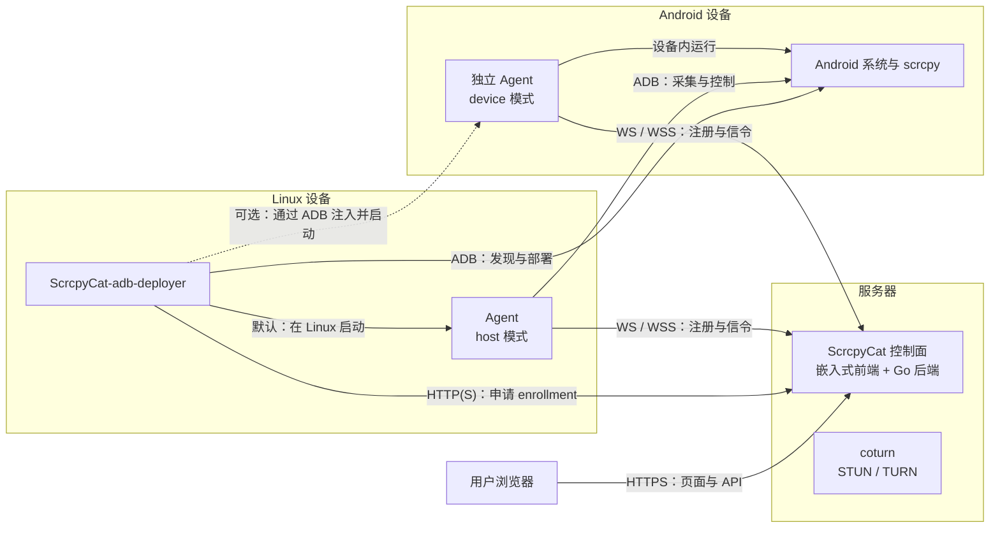
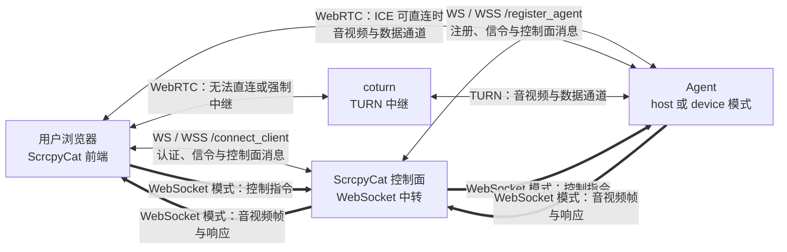

# ScrcpyCat

ScrcpyCat 是自托管的 Android 远程设备管理平台，支持在浏览器中投屏控制手机、管理多台设备，以及使用音视频、终端和文件功能。

Go 控制面内嵌 Vue 前端，Agent 通过 scrcpy 采集与控制 Android，支持 WebRTC 和 WebSocket 两种连接方式。

[使用文档](https://github.com/CwithW/ScrcpyCat/wiki) · [版本下载](https://github.com/CwithW/ScrcpyCat/releases) · [问题反馈](https://github.com/CwithW/ScrcpyCat/issues)

## 主要功能

- 投屏控制：触控、按键、剪贴板、截图与按键映射。
- 音视频：手机摄像头、麦克风、设备音频、抓拍与浏览器录像。
- 多设备管理：高密列表、标签、实时预览、监控大盘与多窗口控制。
- 远程运维：PTY 终端、文件传输、APK 安装、应用管理与批量任务。
- 权限与分享：设备分配、操作权限、画质策略、分享链接与卡密。
- 设备接入：Linux USB 自动部署和 Android 独立 Agent。

## 界面预览

桌面端设备控制：

移动端设备控制：

## 架构

控制面提供网页、API 与信令；USB 部署器在 Linux 上启动 host Agent，或将 device Agent 部署到 Android。coturn 可与控制面同机或独立运行。

WebRTC 通过控制面交换信令，音视频与数据通道直连 Agent 或经 TURN 中继；WebSocket 投屏由控制面转发。

## 部署与使用

部署、配置与运维步骤统一见 [Wiki](https://github.com/CwithW/ScrcpyCat/wiki)。官方镜像支持 Linux amd64/arm64，控制面与全部 USB 部署器应使用相同版本。

| 内容 | 文档 |
| --- | --- |
| 架构与环境 | [架构说明](https://github.com/CwithW/ScrcpyCat/wiki/Architecture) |
| 服务端部署 | [Linux 服务端](https://github.com/CwithW/ScrcpyCat/wiki/Server-Deployment) |
| 网络与中继 | [TURN 与网络](https://github.com/CwithW/ScrcpyCat/wiki/TURN-and-Network) |
| 设备接入 | [Linux USB 部署器](https://github.com/CwithW/ScrcpyCat/wiki/USB-Deployer) · [Android Agent](https://github.com/CwithW/ScrcpyCat/wiki/Android-Agent) |
| 日常使用 | [设备矩阵](https://github.com/CwithW/ScrcpyCat/wiki/Device-Matrix) · [连接设置](https://github.com/CwithW/ScrcpyCat/wiki/Connection-Settings) |
| 运维维护 | [升级与备份](https://github.com/CwithW/ScrcpyCat/wiki/Operations) · [故障排查](https://github.com/CwithW/ScrcpyCat/wiki/Troubleshooting) |
| 开发构建 | [源码构建与开发](https://github.com/CwithW/ScrcpyCat/wiki/Development) |

## 许可证与致谢

本项目代码与修改采用 [Apache License 2.0](LICENSE)，第三方组件保留各自许可。来源与修改记录见 [NOTICE](NOTICE)。

感谢 [scrcpy](https://github.com/Genymobile/scrcpy)、[ScrcpyOverWebRTC 前端](https://github.com/hqw700/ScrcpyOverWebRTC)、[gadb](https://github.com/electricbubble/gadb)、[Pion WebRTC](https://github.com/pion/webrtc)及其他开源项目。
